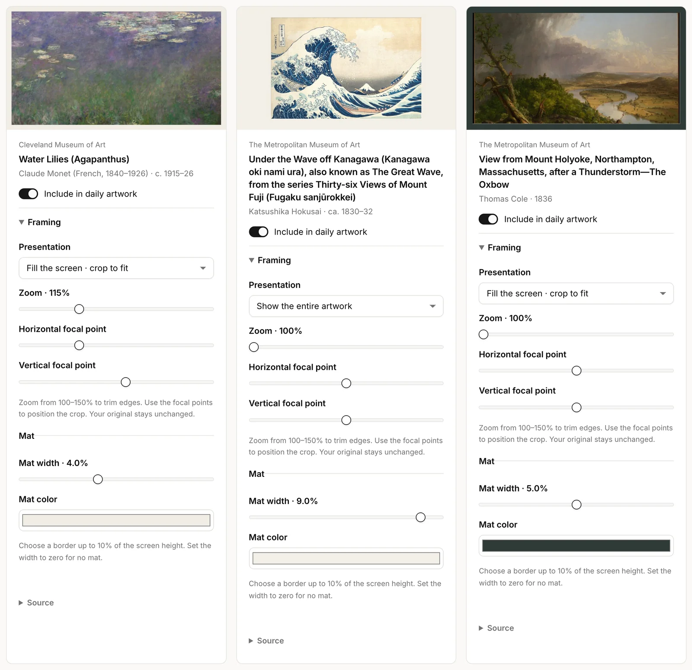
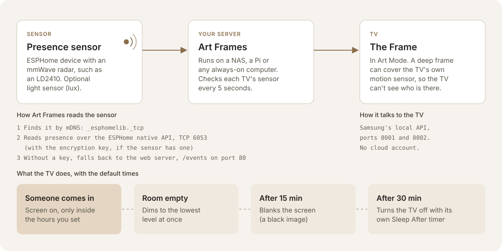
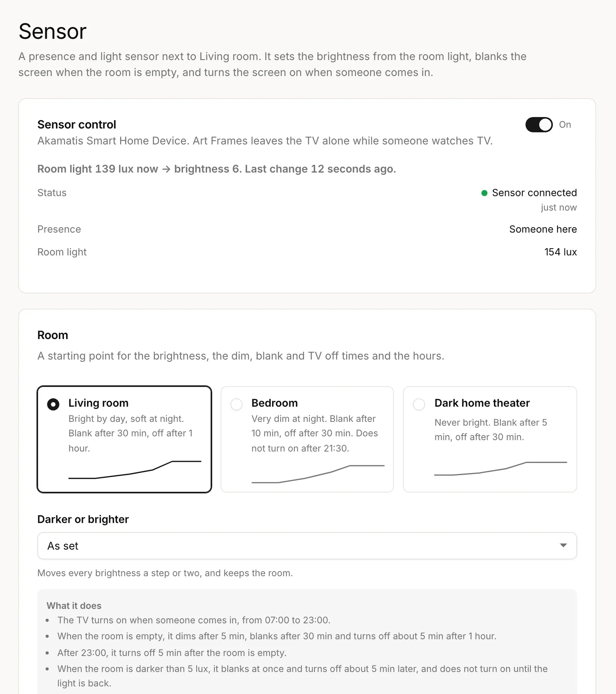
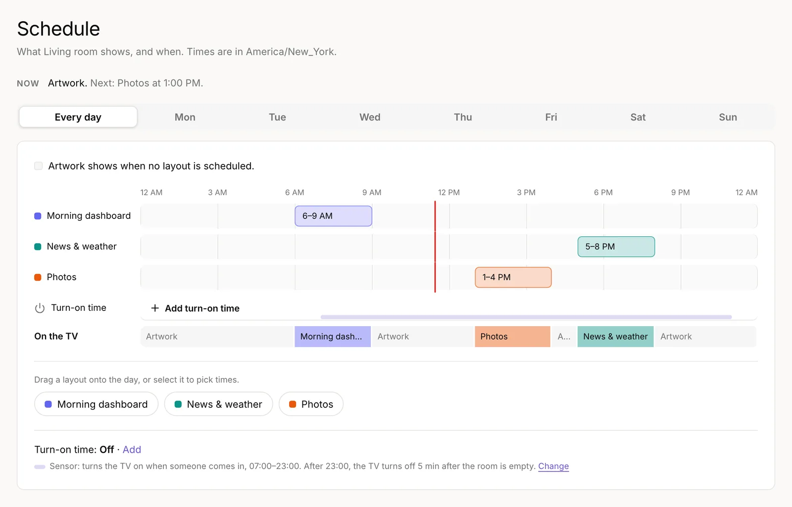
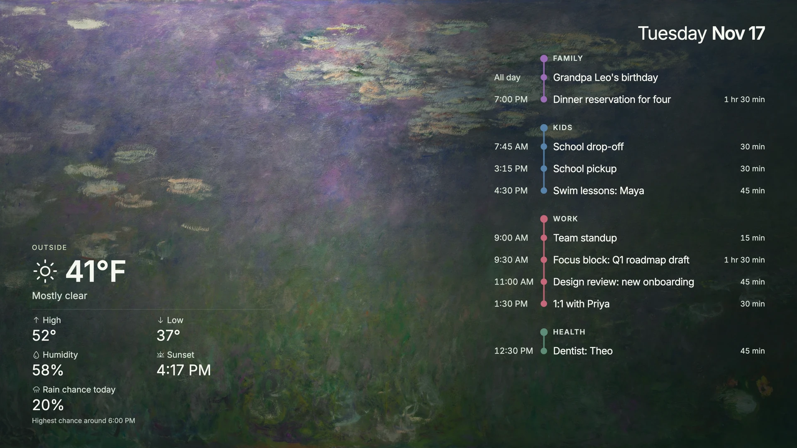
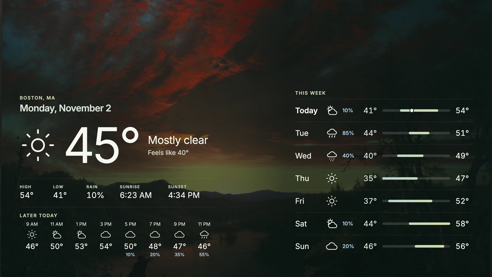
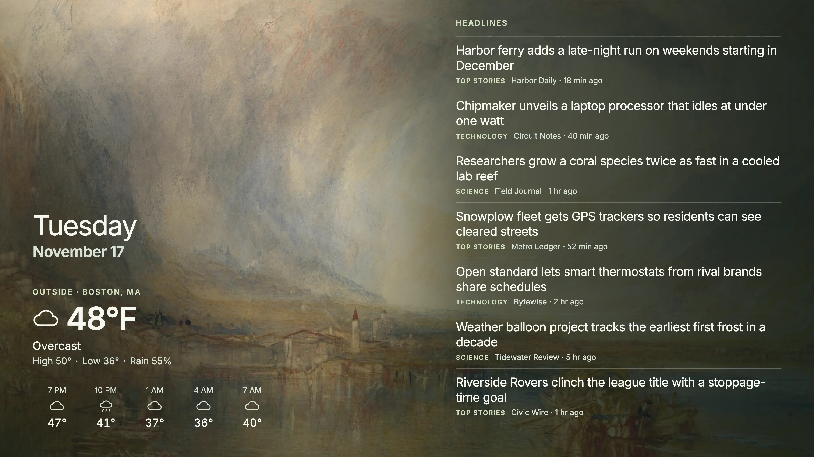
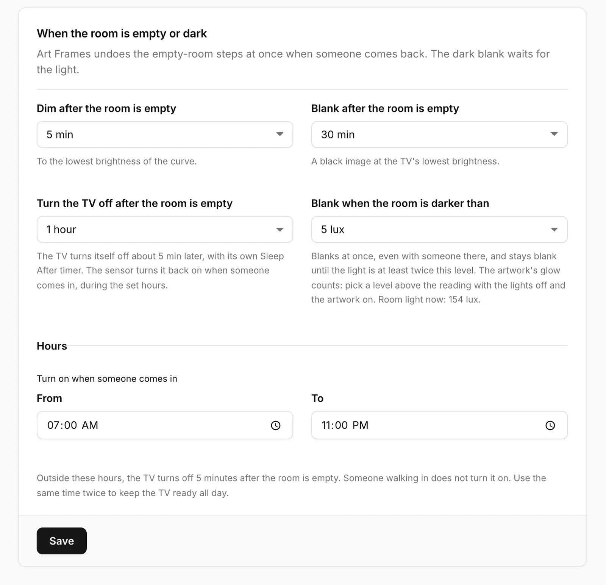

# Art Frames

<picture>
  <source media="(prefers-color-scheme: dark)" srcset="docs/images/lockup-dark.svg">
  
</picture>

**Museum art and your own layouts on Samsung The Frame.**


Art Frames is free, open-source software for Samsung The Frame TVs. It runs in Docker on a NAS or any computer that stays on in your home. It does three things:

- It puts a new painting on each TV every day: public-domain museum art, or your own images.
- It shows layouts over the art at the times you choose. A layout is a small website, such as a morning dashboard, that Art Frames renders to a 4K image.
- With an optional room sensor, it turns the screen on when someone comes in, and blanks it when the room is empty or dark.

Art Frames runs on your home network and needs no cloud account. To start, see [What you need](#what-you-need) and [Install](#install).

This is an early release. Pairing, delivery, scheduled wake and sleep need tests on more TV models. See [compatibility](docs/compatibility.md).

Art Frames was called Dayframe. You still see that name in two places. When you pair a TV, the TV asks you to allow an app named "Dayframe". And each `ART_FRAMES_*` setting also works with the older `DAYFRAME_` prefix.

## What it does

### Free art, all day



Search the open-access collections of the Cleveland Museum of Art, the Met and the Art Institute of Chicago, or upload your own images. Art Frames picks a new piece each day, in order or shuffled, at the time you set. Give each piece a mat: choose fit or zoom, the focal point, and the mat's width and color. The art is the background on every TV.

### A room sensor turns the TV on and off



A deep frame can cover the Frame's own motion sensor. Art Frames can use a small ESPHome presence sensor instead. Inside the hours you set, someone walking in turns the screen on. When the room is empty, Art Frames dims the screen, blanks it, and then lets the TV turn itself off. When the room is dark (below 5 lux by default), it blanks the screen at once and keeps it off until the light is back. See [Presence sensor](#presence-sensor).



### Layouts over the art, on a schedule



Put layouts on a weekly schedule as blocks over the artwork: a morning dashboard before work, photos in the afternoon, news and weather in the evening. Outside the blocks, the TV shows art. Each TV has its own schedule, and one server runs up to eight TVs.

| Morning dashboard | Weather | News & weather | Photos |
| --- | --- | --- | --- |
|  |  |  |  |

These layouts live in the [art-frames-layouts](https://github.com/brianmuse/art-frames-layouts) repository. Weather, Google Calendar, styling and artwork blur belong to the layouts, not to Art Frames. The install file runs Morning dashboard, News & weather and Weather. To add Photos or your own layout, use a source install: see [Deployment from your computer](docs/cli-deployment.md#layouts) and [the website contract](docs/website.md).

The images use made-up sample data. The museum art is in the public domain; see [image credits](docs/images/CREDITS.md).

## Presence sensor

The Frame turns its screen off when its own motion sensor sees no one. A deep frame or a wall recess can cover that sensor. Then the TV can't tell if anyone is there. An external sensor solves that.

- **Hardware:** an ESPHome device with a presence reading, for example one with an LD2410 mmWave radar. Art Frames knows the readings of the Apollo MSR-1, MSR-2 and MTR-1, the Everything Presence One and Lite, SCREEK, Seeed MR60 kits and Akamatis devices. For other devices, it picks the reading by its device class (occupancy, presence or motion), or you choose it.
- **Discovery:** the Sensor page finds sensors by mDNS (`_esphomelib._tcp`). This needs the host network. In Docker bridge mode, type the sensor's IP address.
- **Link:** Art Frames reads presence and light over the ESPHome native API on TCP port `6053`, with the sensor's encryption key if it has one. Without a key, it can fall back to the sensor's web server (`/events` on port 80). A reading older than 2 minutes counts as missing, and a missing reading never changes the TV.
- **What it controls, for each TV:**
  1. Someone comes in inside the hours you set (default 07:00–23:00): the screen turns on.
  2. The room is empty: the screen dims at once and blanks after 15 min. At 30 min, Art Frames lets the TV turn itself off, about 5 min later. These are the defaults; you can change each time.
  3. The room is dark (default: below 5 lux): the screen blanks at once, even with someone there, and the TV turns itself off about 5 min later. Nothing turns it on until the light is at least twice that level and someone is there. Pick **Never** to turn this off.
  4. With a light reading, the brightness follows the room light.
- **How "off" works:** on a Frame in Art Mode, the power key does nothing. Art Frames sets the TV's own **Sleep After** timer to its shortest value, and the TV turns itself off. It saves your own Sleep After value first and puts it back when you turn sensor control off.



Art Frames never stores, logs or shows the sensor's MAC address. It keeps the encryption key in its private settings file, and never shows it on a page or in the log. For every setting, see [when the room is empty](docs/configuration.md#room-sensor-when-the-room-is-empty) and [when the room is dark](docs/configuration.md#room-sensor-when-the-room-is-dark).

## What you need

- A Samsung The Frame TV.
- A computer or NAS that stays on, with Docker, on the same home network as the TV. It must be 64-bit (amd64 or arm64). A Raspberry Pi 4 or 5 with 2 GB or more and the 64-bit Raspberry Pi OS should work, but it is not on the [compatibility](docs/compatibility.md) list yet. The images have no 32-bit build.
- A fixed IP address for the TV. Reserve it in your router (a DHCP reservation).
- For a scheduled wake: on the TV, turn on **Power On with Mobile** and **IP Remote**.

## Install

You do not need SSH. On a NAS or with Portainer, you can do every step in the web pages of its Docker app. With plain Docker Compose, you type a few commands to start and to update.

The GitHub releases of this repository and of the [layouts repository](https://github.com/brianmuse/art-frames-layouts) publish the images that the install file uses, so the install file needs a release of each (v0.1.0 or later).

1. Make an empty folder, for example `art-frames`.
2. Put [`install/docker-compose.yml`](install/docker-compose.yml) in it. To download it from a terminal, run this in the folder:

   ```sh
   curl -O https://raw.githubusercontent.com/brianmuse/art-frames/main/install/docker-compose.yml
   ```

3. Run `docker compose up -d` in that folder, or paste the file into your NAS's Docker app (see below).
4. Open the log (`docker compose logs art-frames`). It shows the address and a setup link with the setup code. Open the link on a phone or computer on your home network and create a password.

The install runs Art Frames (`ghcr.io/brianmuse/art-frames`), the HTML/CSS renderer (`ghcr.io/brianmuse/art-frames-renderer-static`) and three layouts from the [layouts repository](https://github.com/brianmuse/art-frames-layouts): **Morning dashboard** (calendar and weather), **News & weather** and **Weather** (`ghcr.io/brianmuse/art-frames-layout-<name>`). Each layout runs in its own container. It uses the network only to fetch its own data, and it sees only its own settings.

### Or ask your AI agent

If you use a coding agent (such as Claude Code) that can reach your server, over SSH or a terminal on the server itself, paste this prompt:

```text
Install Art Frames on my home server: https://github.com/brianmuse/art-frames

1. Check the server: 64-bit (amd64 or arm64), Docker with Compose, on the same home network as my Samsung The Frame TV. Tell me what is missing instead of installing system packages.
2. Make a folder named art-frames, and download install/docker-compose.yml from the repository's main branch into it. Show me the file before you start it.
3. Run `docker compose up -d` in that folder, then `docker compose logs art-frames`.
4. Give me the address and the setup link from the log. Stop there: I open the link and create the password myself.
Do not forward ports on my router, and do not change other containers.
```

On a NAS with a Docker app and no terminal, follow the steps for your NAS below.

Art Frames serves plain HTTP on your home network. Do not forward port 8765 from your router. For HTTPS, see [Access and networking](docs/hosting.md#access-and-networking).

### Docker Compose on Linux

1. Run `docker compose up -d` in the folder.
2. Run `docker compose logs art-frames` to see the address and the setup link.

The log has no QR code, because Art Frames runs in the background. After you sign in, the **Server** page shows a QR code of the address for your phone.

The file uses the host network. Art Frames then can search for your TV, wake it, find a presence sensor and answer at `http://art-frames.local:8765`.

### Synology Container Manager

1. In File Station, make a folder, for example `docker/art-frames`.
2. Open **Container Manager → Project → Create**. Name the project `art-frames`. Choose the folder as the path. Choose **Create docker-compose.yml** and paste the file.
3. Finish the wizard. Open **Container → art-frames → Log** to see the address and the setup link.

Name the project `art-frames`, so the data volume is `art-frames_data` as in these docs. The install file already uses the HTML/CSS renderer. Many Synology kernels can't run the Chromium renderer. See [Synology installation](docs/synology.md), also for updates and backups.

### Unraid

Unraid keeps app data in `/mnt/user/appdata`, where its backup tools look. Use a folder there instead of the named volume.

1. Open **Terminal** (the `>_` icon at the top of the Unraid web page) and run:

   ```sh
   mkdir -p /mnt/user/appdata/art-frames
   chown -R 10001:10001 /mnt/user/appdata/art-frames
   ```

2. Install the **Compose Manager** plugin from **Apps**.
3. Open **Docker → Compose → Add new stack**. Name it `art-frames` and paste the file.
4. In the pasted file, change the line `- data:/data` to `- /mnt/user/appdata/art-frames:/data`.
5. Select **Compose Up**. Open the log of the `art-frames` container to see the address and the setup link.

Keep the host network: it is in the file.

### Portainer

1. Open **Stacks → Add stack**. Name it `art-frames`.
2. Paste the file into the web editor and select **Deploy the stack**.
3. Open **Containers → art-frames → Logs** to see the address and the setup link.

### Docker Desktop on a Mac or Windows PC

Docker Desktop has no host network on your home network. Add [`install/docker-compose.bridge.yml`](install/docker-compose.bridge.yml) next to the main file:

```sh
curl -O https://raw.githubusercontent.com/brianmuse/art-frames/main/install/docker-compose.bridge.yml
docker compose -f docker-compose.yml -f docker-compose.bridge.yml up -d
```

Then open `http://localhost:8765`. From a phone, use `http://<this computer's IP>:8765`. In this mode Art Frames can't search for the TV, wake it or answer at `art-frames.local`. Type the TV's IP address in setup.

To see the log, open **Containers → art-frames → art-frames → Logs** in Docker Desktop. In this mode the log shows the setup code, but no setup link: Art Frames can't see this computer's address. Type the code on the setup page.

### First visit

1. Open the setup link from the log. It fills in the setup code. On Docker Desktop, open `http://localhost:8765` and type the code from the log. The code works for 1 hour.
2. Create a password of at least 12 characters.
3. Follow the setup steps on Home: add your TV, pair it and choose what it shows.
4. When you pair, the TV shows a prompt to allow "Dayframe". Select **Allow** on the TV.

By default the TV shows the day's artwork. To show a layout, pick a starter plan on Home, or add a block for the layout on the TV's **Schedule** page. Then open the layout under **Layouts** and set what it needs: a city for the weather, or your calendar links for Morning dashboard. A layout with nothing set still works: it leaves out the weather or the calendar. Other layouts, such as Photos, and your own website need a source install for now; see [layout packages](docs/layouts.md) and [the website contract](docs/website.md).

Each device stays signed in for 30 days after its last visit. To see the address again, open **Server** in the sidebar. With the host network, it also has a QR code for your phone.

To learn the pages of Art Frames, see [Using Art Frames](docs/using.md).

### Updating

1. Download a backup first: **Server → Export settings → Download backup**. Tick **Include private values**.
2. Run `docker compose pull`, then `docker compose up -d`. On Synology, follow [the update steps](docs/synology.md#update). In Portainer, open the stack and select **Update the stack** with **Re-pull image** on. On Unraid, select **Compose Pull**, then **Compose Up**.
3. To stay on one version, put `ART_FRAMES_VERSION=0.1` and `ART_FRAMES_LAYOUTS_VERSION=0.1` (for example) in a `.env` file next to the compose file. In Portainer or Unraid, change `latest` in the `image:` lines instead.

To go back to an older version, restore the data backup too. An older version may not read settings that a newer one wrote.

Art Frames never updates itself. Once a day it asks GitHub for the newest version number and shows "Art Frames X is out" at the bottom of the sidebar, where X is the new version. It sends nothing about you. Turn it off in **Server → Updates**, or set `ART_FRAMES_UPDATE_CHECK: "0"` under `environment:`.

### Backups

- **Settings only:** open **Server → Export settings** and select **Download backup**. Tick **Include private values** to keep TV pairings, sensor keys and layout keys. Keep that file as safe as a password. Without that tick, the file still holds the TVs' IP addresses, but not their MAC addresses. **Server → Import settings → Import backup** brings the settings back. Art Frames keeps a copy of the current settings first.
- **Everything:** stop Art Frames, then copy the whole data volume. With Docker Compose the volume is `art-frames_data`:

  ```sh
  docker compose stop
  docker run --rm -v art-frames_data:/data:ro -v "$PWD":/backup alpine tar -czf /backup/art-frames-data.tar.gz -C /data .
  docker compose start
  ```

  On Unraid, back up `/mnt/user/appdata/art-frames`. The copy holds your password hash and TV pairings. Keep it private.

### Troubleshooting

- **Art Frames does not find the TV.** Use the host network (the default file). Turn the TV on. The TV and the server must be on the same network. Type the network range, for example `192.168.1.0/24`, or type the TV's IP address. Art Frames talks to the TV on ports 8001 and 8002.
- **`art-frames.local` does not open.** Use the IP address from the log or the Server page. Some routers, guest networks and mesh Wi-Fi block `.local` names. Docker bridge mode can't announce the name.
- **Two installs on one network.** Give each its own name: add `ART_FRAMES_MDNS_NAME: kitchen-frames` (for example) under `environment:`. Otherwise mDNS renames the second one, and the log says which name it got.
- **"Art Frames cannot write to its data folder".** The install file uses a named volume, which needs no change. If you use a host folder, give that folder to user 10001: `sudo chown -R 10001:10001 <folder>`.
- **You forgot the password.** Add `ART_FRAMES_RESET_PASSWORD: "1"` under `environment:` for the `art-frames` service and start it again. The log then shows a new setup link. Create a new password. Then remove the line and start Art Frames again: each start with it set resets the password once more. Your TVs and settings stay, and the old password file is kept as `auth-before-reset.json`. This works from a NAS's Docker app too. If your install uses a password file (`.secrets/web_password`), the reset does nothing: read the password from that file.
- **A page says `auth.json` is damaged.** Reset the password as above.
- **The setup code expired.** Try once more: Art Frames prints a new code in the log. A restart also makes a new code.
- **"Bad Request" in the browser.** You opened Art Frames with a name it does not answer to, such as a DNS name with dots. Use the IP address, or add that name to `ART_FRAMES_HOSTS` under `environment:`, for example `ART_FRAMES_HOSTS: "*,frames.home.arpa"`.
- **"Too many tries".** After 5 wrong passwords in a minute, Art Frames waits a minute. Behind a reverse proxy, a tunnel or Docker Desktop, every device has the same address for Art Frames, so they share that limit.
- **Raspberry Pi: "exec format error" or no matching image.** Use the 64-bit Raspberry Pi OS on a Pi 4 or 5.
- **Synology: the renderer does not start.** Use the HTML/CSS renderer, as the install file does. See [Synology installation](docs/synology.md).

## Uninstall

1. If you may want your settings again, download a backup first (see [Backups](#backups)).
2. In the install folder, run `docker compose down -v`. This stops Art Frames and removes its containers. The `-v` also deletes the data volume, with your settings, artwork and TV pairings. On Unraid, also delete `/mnt/user/appdata/art-frames`.
3. On each TV, remove "Dayframe" from the list of connected devices in the TV's device connection settings.

## For developers

To build Art Frames from source, install layouts from the layouts repository, or deploy to a NAS over SSH, read these pages:

- [Deployment from your computer](docs/cli-deployment.md): the SSH helper, layout installs and rollback.
- [Contributing](CONTRIBUTING.md): the development setup, checks and rules. To share a layout you made, send it to [art-frames-layouts](https://github.com/brianmuse/art-frames-layouts).
- [Hosting](docs/hosting.md), [configuration](docs/configuration.md), [layout packages](docs/layouts.md), [the website contract](docs/website.md), [renderer choices](docs/renderers.md) and [architecture](docs/architecture.md).
- [Releasing](docs/releasing.md) and [security](SECURITY.md).

## License and credits

- Art Frames is free software under the [MIT License](LICENSE).
- [Third-party notices](THIRD_PARTY_NOTICES.md) list the licenses of the bundled code and fonts.
- The museum art in these images is in the public domain (CC0). See [image credits](docs/images/CREDITS.md).
- Samsung and The Frame are trademarks of Samsung. Art Frames is not affiliated with Samsung.
